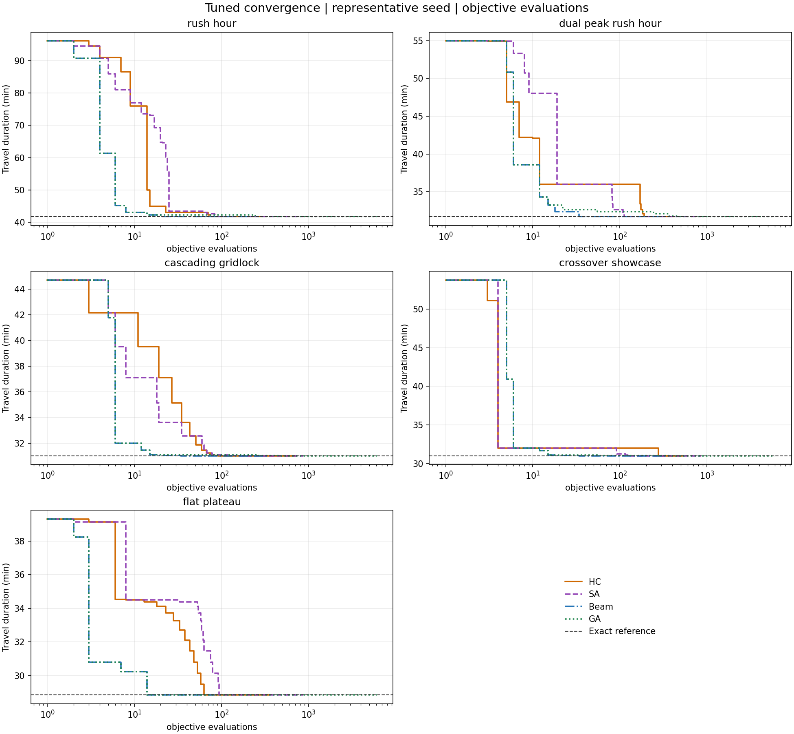

# گزارش بهینه‌سازی سفر شهری

## پیاده‌سازی

همسایه‌ها با تغییر یک گام ساعت یا جایگزینی بخشی از مسیر ساخته می‌شوند. برای جایگزینی از BFS تا یکی از گره‌های بعدی استفاده کردم؛ بخش قبلی مسدود می‌شود و اتصال و نبود گره تکراری دوباره بررسی می‌شود.

HC حرکت افقی محدود و شروع مجدد دارد؛ SA از متروپولیس و کاهش نمایی دما استفاده می‌کند. Beam از مجموعهٔ مشترک همسایه‌ها انتخاب می‌کند. در GA انتخاب Tournament، برازندگی `1/(1+cost)`، ترکیب، جهش و حفظ نخبگان پیاده شد. امضای توابع و موتور شبیه‌سازی تغییر نکرد.

## نتایج

۵۷۵ اجرای تنظیم و ۴۰۰ اجرای ارزیابی روی پنج سناریو، با seedهای جدا انجام شد. جدول مربوط به پیش‌فرض‌ها و ۱۰ اجرای `rush_hour` است؛ زمان‌ها میانگین‌اند.

| روش | بهترین / میانگین سفر (دقیقه) | حرکتِ بهترین جواب | اجرا (ثانیه) | گام رسیدن به جواب نهایی |
| --- | ---: | --- | ---: | ---: |
| HC | 41.773 / 41.773 | 08:45 | 0.00391 | 17.4 |
| SA | 41.773 / 41.773 | 08:45 | 0.04975 | 534.5 |
| Beam | 41.773 / 42.170 | 08:45 | 0.00231 | 2.3 |
| GA | 41.773 / 41.773 | 08:45 | 0.18530 | 4.4 |

مسیر بهترین جواب هر چهار روش: `Home → B1 → B2 → H2 → Uni`.

«گام رسیدن» اولین مشاهدهٔ جواب نهایی است، نه اثبات همگرایی؛ واحد گام روش‌ها متفاوت است. [نتایج پنج سناریو](results/summary.csv) ذخیره شده‌اند. جواب دقیق فقط برای ارزیابی نقشه‌های کوچک محاسبه شد و وارد الگوریتم‌ها نشد.

## نمودار و تنظیم پارامترها

نمودار برای تنظیمات منتخب و seed برابر ۴۲ است. [نمودار برحسب گام](results/convergence_steps.png) هم موجود است. HC افت حریصانه و توقف روی سطح هم‌هزینه دارد. SA با پذیرش حرکت بدتر از درهٔ محلی عبور می‌کند؛ [نوسان مسیر جاری](results/annealing_trajectory.png) از منحنی بهترین جواب جداست. Beam زودتر متوقف می‌شود و GA بهبود نسل‌ها را حفظ می‌کند.

در ارزیابی، دمای اولیهٔ ۱ برای SA سریع‌تر بود، ولی موفقیت از ۱۰۰٪ به ۹۴٪ افت کرد. عرض ۱۶ برای Beam موفقیت کلی را از ۹۲٪ به ۹۶٪ رساند، اما روی سناریوی مسطح ضعیف‌تر شد. GA با همان پیش‌فرض انتخاب شد؛ تنظیمات اصلی را حفظ کردم.

## پاسخ پرسش‌ها

### ۱. گرادیان نزولی

مسیر گسسته است و مشتق معمول ندارد. برای مسیر ثابت و زمان پیوسته، مشتق‌پذیری `C_e(t)` امکان محاسبهٔ گرادیان را می‌دهد؛ گرادیان لیپشیتز و گام مناسب نزول را تضمین می‌کنند. گوسی با `sigma > 0` نرم است، ولی تضمین کمینهٔ سراسری نداریم. خروجی باید به شبکهٔ زمانی برگردانده و ارزیابی شود.

### ۲. جست‌وجوی محلی و تدریجی

نمایش کامل، تغییر هم‌زمان مسیر و ساعت و محاسبهٔ ترافیکِ مراحل بعد را ساده می‌کند. برای ساعت ثابت و شبکهٔ FIFO، دایکسترای وابسته به زمان هم درست است. بازه‌های زمانی متعدد، محدودیت کل مسیر یا نقض FIFO کار را سخت‌تر می‌کنند؛ جست‌وجوی محلی با بودجهٔ محدود جواب تقریبی می‌دهد.

### ۳. Beam و ژنتیک

ترکیب، بخش‌های خوب دو والد را یکجا می‌سازد؛ Beam فقط همسایه‌ها را انتخاب می‌کند. با پیش‌فرض و seed برابر ۴۲، تنوع Beam در سناریوی دو اوج از ۶ به ۲ رسید؛ فروپاشی کامل ندیدم. حالت تکراری حذف شد؛ محدودکردن سهم هر مسیر یا افزودن حالت تصادفی هم می‌تواند کمک کند.

### ۴. حرکت افقی

مسیرهای هم‌طول با ترافیک مشابه، سطح هم‌هزینه می‌سازند. حرکت افقی کمک می‌کند از آن عبور کنیم، ولی سقف زیاد رفت‌وبرگشت اضافی دارد. سقف صفر نسبت به ۱۰۰، کیفیت ارزیابی را کم نکرد و زمان متوسط پنج سناریو از حدود ۴۵ به ۶ میلی‌ثانیه رسید؛ این نتیجه مختص همین داده‌هاست.

### ۵. برنامهٔ سرمایش

دمای بالا حرکت بد زیادی می‌پذیرد؛ دمای پایین خطر گیرکردن دارد. روی seedهای تنظیم، `alpha=0.5` میانگین فاصلهٔ ۱۹٫۱۶٪ از جواب دقیق داشت؛ `alpha=0.999` فاصلهٔ صفر داشت، ولی به سقف ۳۰۰۰ تکرار رسید. سرمایش سریع ارزان‌تر و کم‌کیفیت‌تر بود.

### ۶. مسیرهای مجزا و وابستگی اجزا

بدون تقاطع میانی مشترک، مسیر یکی از والدها حفظ و ساعت میانگین به نزدیک‌ترین زمان مجاز تبدیل می‌شود. فرزند دو والد خوب هم ممکن است بد باشد: تغییر بخش اول یا ساعت حرکت، زمان ورود به بخش دوم را عوض می‌کند و خودرو به اوج ترافیک می‌رسد.

### ۷. اندازهٔ فضای حالت

تخمین `N_t b^L` با میانگین‌ها کران قطعی نیست. با `n=|V|` و حداکثر درجهٔ خروجی `d`، برای مسیر بدون دور داریم:

$$|X| \le N_t\sum_{\ell=1}^{n-1}d^\ell.$$

رشد نمایی، شمارش کامل را در شبکهٔ بزرگ پرهزینه می‌کند؛ جست‌وجوی محلی بخشی از حالت‌ها را بررسی می‌کند و تضمین جواب سراسری ندارد.

## اجرا و استفاده از ابزار

هر ۶۵ تست پاس شد. اجرای آزمایش‌ها: `python experiments/benchmark.py`.

از Codex برای کد، تست، آزمایش و نگارش استفاده شد. دستورها شامل «تمام کار های که گفته شده رو انجام بده با رعایت همه ی نکات که در pdf ذکر شده» و «با لحن دانشجویی و انسانی بنویس» بود.
