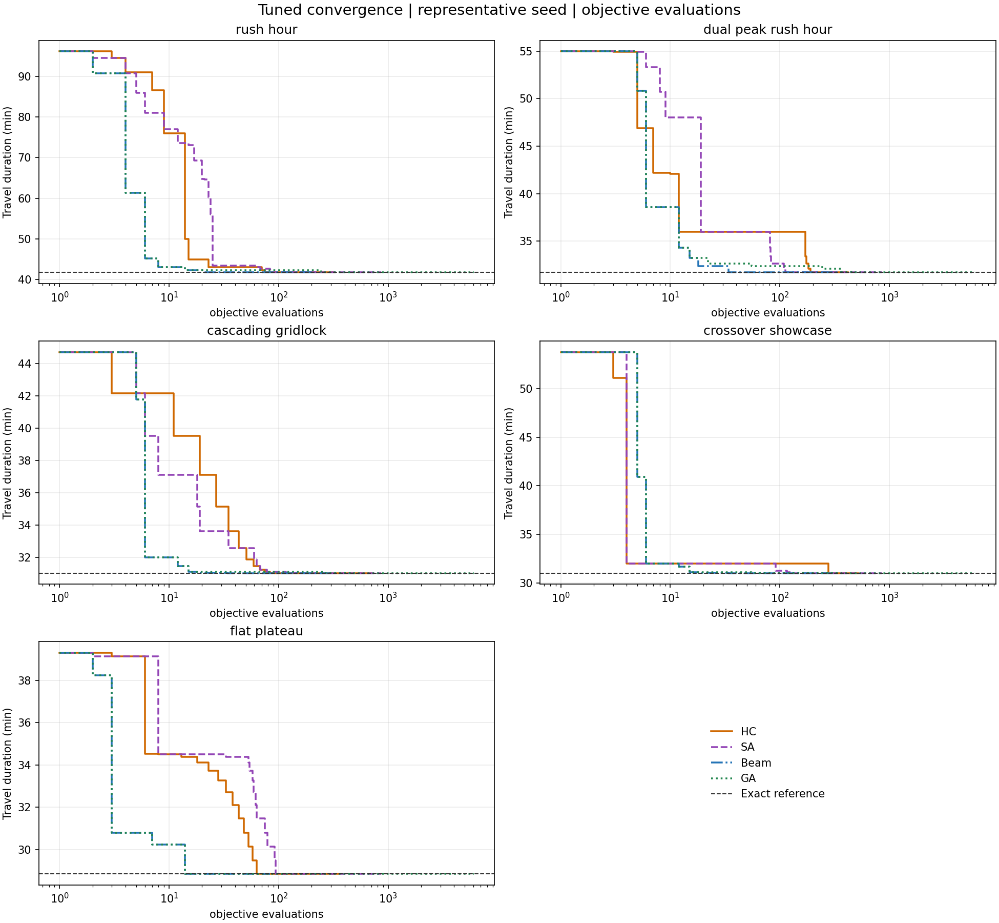
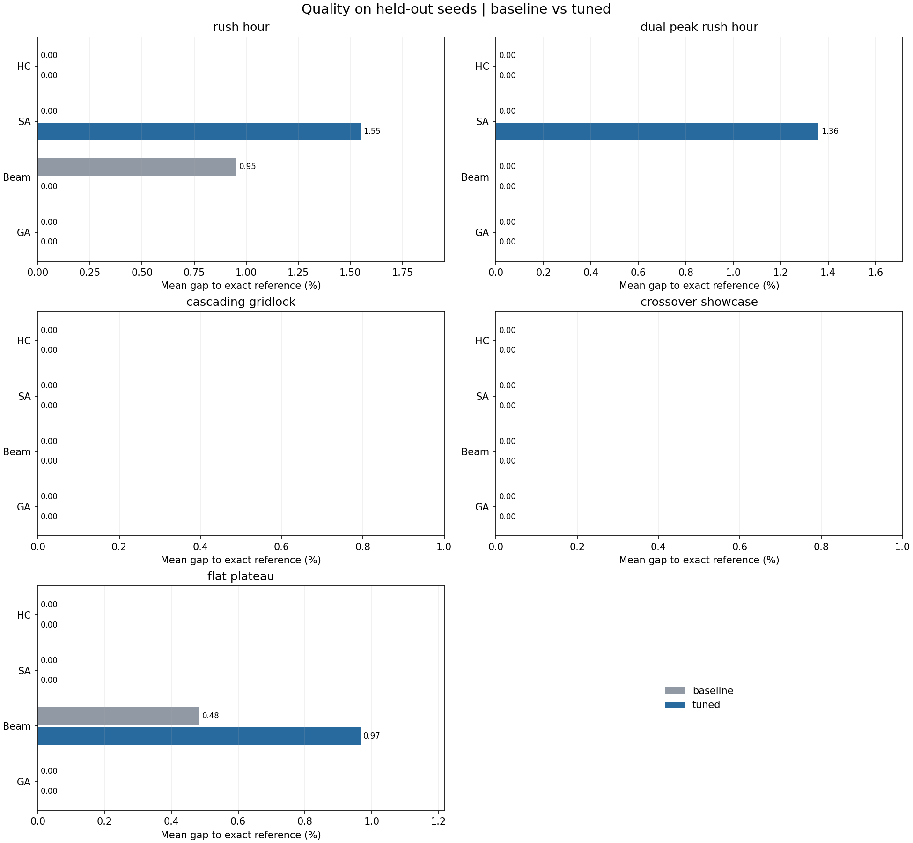

# Measured experiment snapshot

This snapshot contains **575 tuning runs and 400 held-out evaluation runs**.
Each profile/algorithm has 50 evaluation trials: five scenarios times ten seeds.
Settings called `tuned` are candidates selected on tuning seeds; that label does
not mean they outperform baseline on new seeds. Default `config.json` is retained.

## Held-out results, pooled across the five scenarios

| Profile | Algorithm | Exact optimum reached | Mean gap (%) | Mean objective calls | Mean runtime (ms) |
| --- | --- | ---: | ---: | ---: | ---: |
| Baseline | HC | 50/50 | 0.000 | 3761.08 | 44.948 |
| Selected | HC | 50/50 | 0.000 | 448.34 | 6.103 |
| Baseline | SA | 50/50 | 0.000 | 1458.00 | 67.987 |
| Selected | SA | 47/50 | 0.581 | 862.00 | 39.167 |
| Baseline | Beam | 46/50 | 0.287 | 222.12 | 3.129 |
| Selected | Beam | 48/50 | 0.193 | 342.08 | 4.893 |
| Baseline | GA | 50/50 | 0.000 | 6050.00 | 203.294 |
| Selected | GA | 50/50 | 0.000 | 6050.00 | 200.077 |

The GA configuration is identical in both profiles; its timing difference is
measurement variation. These instrumented timings are observations on this
machine, not portable speed guarantees. Scenario-level means and sample standard
deviations are in [summary.csv](summary.csv); each measured run is in [runs.csv](runs.csv).

## Selected candidates and tradeoffs

- HC: `max_sideways=0`, retaining ten restarts. This reduced objective calls
  without losing solution quality in the 50 evaluation trials. It does not show
  that sideways moves are unnecessary on other landscapes.
- SA: `initial_temp=1.0`, retaining `cooling_rate=0.992`. It matched the exact
  reference on all 25 tuning trials, but missed it on three held-out trials
  (two rush-hour and one dual-peak). This is a measured speed/quality tradeoff,
  so it is not promoted to the default.
- Beam: `beam_width=16`. Overall success rose from 46/50 to 48/50, with more
  objective calls. In the flat-plateau scenario success fell from 9/10 to 8/10;
  larger width is not a monotonic quality guarantee with these initialization
  and stopping rules. The selected profile is kept for comparison.
- GA: the baseline remains selected. Several candidates had zero tuning gap and
  the same evaluation count; the deterministic variant-name tie-break retained
  baseline. This does not prove its runtime or parameters are uniquely optimal.

## Sensitivity evidence from tuning seeds

- HC without restarts had a mean gap of 2.476%; with two restarts it was 0.509%.
- SA with rapid cooling `alpha=0.5` had a mean gap of 19.161%; `alpha=0.9` had
  4.473%. Baseline and `alpha=0.999` reached zero mean gap, but the latter used
  3001 objective calls versus baseline's 1458.
- Beam width 1 had a mean gap of 4.907%, width 3 had 3.073%, and width 16 had zero
  tuning gap.
- GA without mutation had a mean gap of 0.782%; population size 20 reduced
  objective calls to 2420 but had a 0.128% mean gap.

These comparisons average relative gaps, giving each scenario equal weight.
They use tuning seeds, not the held-out trials in the table above. Full values
and timing/effort measurements are in [tuning_summary.csv](tuning_summary.csv).

## Exact references

| Scenario | Simple routes | Complete states | Minimum duration (min) | One minimizing departure |
| --- | ---: | ---: | ---: | --- |
| rush_hour | 12 | 156 | 41.772617 | 08:45 |
| dual_peak_rush_hour | 33 | 429 | 31.691504 | 08:45 |
| cascading_gridlock | 33 | 429 | 31.018633 | 08:45 |
| crossover_showcase | 33 | 429 | 31.007596 | 08:45 |
| flat_plateau | 10 | 130 | 28.851552 | 08:45 |

Enumeration is practical here because the supplied maps are tiny; it is only an
external reference, never the implementation of a local-search solver. The
objective minimizes travel **duration**, with no arrival deadline. Consequently,
a late departure can be preferred even if it produces a later absolute arrival.

## Figures and reproduction

There are seven diagnostic/comparison figures and twenty route figures. Curves
and routes show representative seed 42; they do not replace the multi-seed tables.
See [experiment methods](../experiments/README.md) for commands, metric definitions,
sampling limits, source hashes, and the distinction between evaluated and accepted
states. This file documents this stored snapshot; a future benchmark rerun may
require updating its narrative and rounded values.
